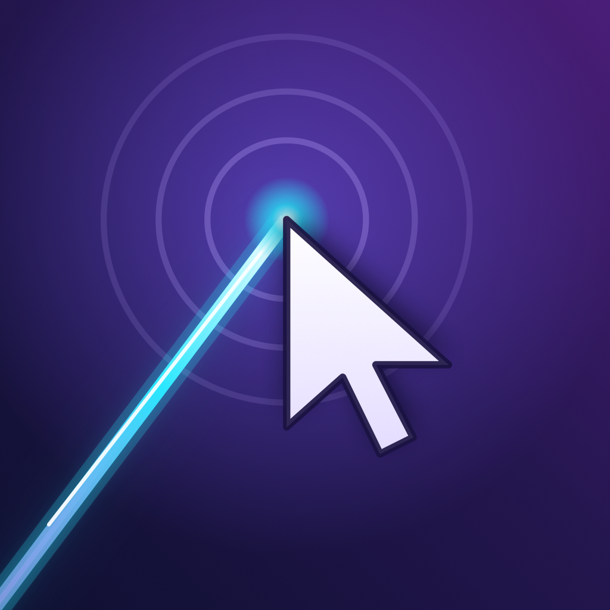

<p align="center">
  
</p>

# AirPoint

**Point your iPhone at a Google TV and click.**

AirPoint turns an iPhone into a remote with a real on-screen pointer for Google TV and Android TV
devices. Aim the phone like a laser pointer (or use the touchpad), click what's under the cursor,
and use real remote keys and the phone keyboard when an app needs them.

It is built for screens where a D-pad is slow: projectors, TV sticks, and battery-powered TV boxes
driving display glasses. It needs no root and works with stock Google TV.

| Part | What it does |
| --- | --- |
| [`android/`](android) | Small app for the TV. An accessibility service draws the cursor, clicks the element under it, and reports screen size and media state. |
| [`ios/`](ios) | The iPhone remote. Streams pointer motion over UDP and talks to the TV's built-in remote service (Android TV Remote v2) for real key presses and typing. |
| [`PROTOCOL.md`](PROTOCOL.md) | The phone ↔ TV pointer protocol. |
| [`tools/atvremote_probe.py`](tools/atvremote_probe.py) | Mac test client for the Android TV Remote protocol: pairing, keys, keyboard. |
| [`tools/make_icon.swift`](tools/make_icon.swift) | Renders the app icon and TV banner. |

## What works

- **Laser pointer**: the cursor goes where the phone points (gyroscope, about 24° across the screen
  at default speed). **Recenter** while aiming at the middle.
- **Touchpad**: drag to move, tap to click, hold for long press, two-finger tap for Back.
  It works with the laser on or off.
- **Scroll strips**: the right strip steps up/down, the bottom strip steps left/right (D-pad);
  tapping a strip selects.
- **OK**: clicks under the cursor while the cursor is showing; otherwise presses the highlighted
  item like a normal remote.
- **Typing**: selecting a text box on the TV opens the phone keyboard. Text is inserted live;
  Backspace and **Delete** remove characters; **Done** presses Enter.
- **Back / Home**, and **Rewind / Play-Pause / Forward** while something is playing.
- **Several TVs**: every TV running the TV app shows up in the menu at the top of the phone app.
- **Wide screens**: on an unfolded iPhone Duo or in landscape, the pad takes the left side for the
  left thumb and every button moves to a right-hand column, with OK largest and lowest.

Tested with a RayNeo Pocket TV Pro (Google TV, Android 14, Amlogic S905X5M) and an iPhone running
iOS 27. Other Google TV and Android TV 13+ devices should work; the TV app needs API 33.

## Setting up a TV

Do this once per TV. You need a Mac with the Android SDK (installing Android Studio is enough;
the build uses its bundled Java runtime) and the TV on the same network as the Mac.

1. **Enable developer options on the TV.** Settings → System → About → click
   **Android TV OS build** 7 times. Then Settings → System → Developer options → turn on
   **USB debugging** (and **Wireless debugging** if offered).
2. **Connect ADB over the network.**
   ```sh
   adb mdns services            # lists TVs advertising ADB, with IP:port
   adb connect <tv-ip>:5555     # approve "Allow USB debugging?" on the TV (tick "Always allow")
   ```
   Some TVs only show an IP and pairing code under Wireless debugging: run
   `adb pair <ip>:<pair-port>` with that code first, then `adb connect`.
3. **Build and install the TV app, and switch on its accessibility service.**
   ```sh
   cd android
   ./build.sh                   # builds build/AirPoint.apk with the SDK tools (no Gradle)
   ./install.sh <tv-ip>:5555
   ```
   `install.sh` installs the APK and enables the service through `adb shell settings`, so there is
   no clicking through accessibility menus. The service survives reboots.
4. **Pair the phone.** Open AirPoint, pick the TV from the menu at the top, tap
   **Pair with this TV**, and enter the 6-character code the TV shows. Pairing enables real OK
   presses, media keys and typing; the pointer itself works without it.

To remove it from a TV: `adb uninstall com.bitbyteco.airpoint`.

## Building the iPhone app

Requirements: Xcode 27 or later, [XcodeGen](https://github.com/yonaskolb/XcodeGen), an Apple
Developer team, and an iPhone on iOS 18 or later.

```sh
cd ios

# 1. Your signing team (this file is not committed).
cp Local.xcconfig.example Local.xcconfig    # then set DEVELOPMENT_TEAM

# 2. The client identity TVs pair with (not committed). Every build made from the same
#    Identity/ folder shares one identity, so a TV paired with one of them trusts all of them.
mkdir -p Identity && cd Identity
openssl req -x509 -newkey rsa:2048 -nodes -days 7300 -subj "/CN=AirPoint Remote" \
  -keyout key.pem -out cert.pem
openssl pkcs12 -export -legacy -inkey key.pem -in cert.pem -name AirPoint \
  -passout pass:airpoint -out identity.p12
cd ..

# 3. Build and install.
xcodegen generate
xcodebuild -project AirPoint.xcodeproj -scheme AirPoint \
  -destination 'id=<device-udid>' -allowProvisioningUpdates build
xcrun devicectl device install app --device <device-udid> \
  build/Build/Products/Debug-iphoneos/AirPoint.app
```

Find the device UDID with `xcrun devicectl list devices`. The bundle IDs (`com.bitbyteco.AirPoint`
for iOS, `com.bitbyteco.airpoint` for Android) can be changed in `ios/project.yml` and
`android/AndroidManifest.xml`; keep `android/install.sh` in sync with the Android one.

## Optional: always-on Tailscale on the TV

If the TV reaches a media server over Tailscale, Android can start Tailscale at boot and restart
it if it stops. Google TV hides the Always-on VPN menu, but ADB can set it:

```sh
adb shell settings put secure always_on_vpn_app com.tailscale.ipn
adb shell settings put secure always_on_vpn_lockdown 0    # keep internet access if Tailscale is down
```

Open the Tailscale app and sign in once first, so Android has granted it VPN permission. Check
after a reboot with `adb shell ip addr show tun0` (a `100.x` address means it's connected). Undo
with `adb shell settings delete secure always_on_vpn_app`.

A media app that seems slow to load is often just waiting for its server over a VPN that is off.

## How it works

```text
iPhone gyroscope / touchpad ──UDP 47800 (Bonjour _airpoint._udp)──▶ TV app: cursor overlay
                                                                    │  click → accessibility action
                                                                    │  on the element under the cursor
iPhone ◀──── "send a real OK" (UDP) ────────────────────────────────┘
   │
   └──TLS 6466 (Android TV Remote v2, paired on 6467)──▶ TV remote service: real keys, keyboard text
```

- **No touch injection.** Google TV devices don't declare a touchscreen, and Android cancels
  accessibility gestures on such devices. Clicks act on the smallest clickable element under the
  cursor instead (full-screen containers are never clicked), and verify that focus landed under
  the cursor before pressing OK.
- **Real keys when needed.** Some apps ignore accessibility clicks and only react to a real remote
  key (Jellyfin's user picker is one). When the phone is paired, the TV app asks the phone to send
  a real OK through the Android TV Remote protocol, the same one the Google TV phone app uses.
- **Typing inserts.** The remote protocol inserts text at the cursor and drops edits that carry a
  stale field counter, so the phone sends only new characters and waits for the TV's echo between
  edits. Deletions are Backspace key presses.
- **Screen size.** Google TV can lay out its UI at 1280×720 on a 1080p panel; the cursor is sized
  from the overlay itself, which uses real pixels.

## Troubleshooting

| Symptom | Check |
| --- | --- |
| Phone says "Searching for TVs…" | The TV app's service is on (`adb shell settings get secure enabled_accessibility_services`) and the phone allowed **Local Network** access (iOS Settings → AirPoint). |
| Cursor moves but clicks do nothing in one app | Pair the phone (gear → Pair again). Paired phones send real OK presses for apps that ignore accessibility clicks. |
| **Type** is greyed out | The phone isn't paired with this TV, or its remote session is reconnecting. |
| Typed text doesn't appear | Close and reopen the TV's keyboard so it starts a fresh session with the phone. |
| Cursor stuck in part of the screen | Reinstall the TV app; older builds sized the cursor from the scaled UI size. |
| What did the TV do with a click? | `adb logcat -s AirPoint` logs every click decision. |

## Limitations

- One tester and a handful of apps so far; expect apps whose clicks need tuning.
- The pointer protocol has **no authentication**: anyone on the local network running AirPoint
  can move the cursor and click on a TV with the service enabled. Use it on trusted networks.
  Real key presses and typing require the one-time pairing.
- Text is inserted at the TV's cursor; editing in the middle of existing text isn't supported.
- Without pairing, typing falls back to key presses for lowercase letters, digits and a few symbols.

## License

[MIT](LICENSE)
